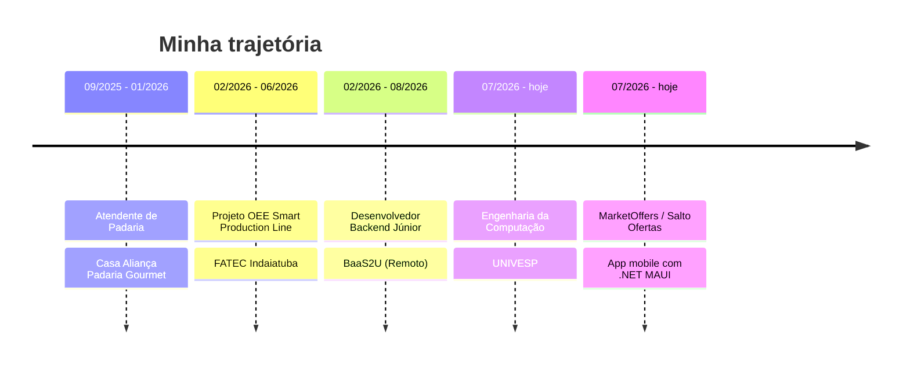
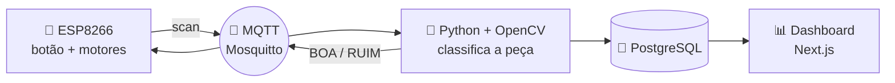

 

---

## 🙋‍♂️ Sobre mim

> 💬 *"Transformar problemas em soluções de software bem estruturadas, eficientes, observáveis e fáceis de manter."*

Sou estudante de **Engenharia da Computação** com foco em desenvolvimento de software e interesse especial por **backend, arquitetura de sistemas e soluções escaláveis**. Gosto de entender não só *como* implementar uma funcionalidade, mas como construir sistemas sólidos.

🔭 Interesses: **microsserviços · bancos de dados · sistemas distribuídos · mensageria · cloud · performance**
🎮 Fora do código: séries, filmes e jogos.

## 🎯 Atualmente

| | |
|---|---|
| 🎓 | Cursando **Engenharia da Computação** na **UNIVESP** (2026–2031) |
| 🤖 | Finalizando um curso da **DIO** sobre **Spring Boot e IA** |
| 📱 | Desenvolvendo o **MarketOffers / Salto Ofertas** com .NET MAUI |
| ☕ | Aprofundando em **Java & Spring Boot** |
| 🔷 | Trabalhando com **C# & .NET** |
| ☁️ | Estudando **Docker, DevOps, cloud e arquitetura** |

## 🛠️ Stack

**Linguagens**

**Backend, Frontend & Mobile**

**Dados, Cloud & Ferramentas**

## 💼 Experiência

### 🧑‍💻 Desenvolvedor Backend Júnior — **BaaS2U** · *02/2026 – 08/2026 · Remoto*

- 🔌 **APIs REST em .NET e C#** para integração entre sistemas e aplicações
- ⚡ **Azure Functions** para automação de tarefas e fluxos serverless
- ☁️ Integração com serviços do **Microsoft Azure**
- 🌐 Site corporativo com **.NET, C# e Razor Pages**
- 🗄️ Funcionalidades e consultas em **SQL Server** + lógica de negócio no backend
- 🔀 Versionamento com **Git** e evolução contínua de aplicações internas

## 🚀 Projetos em destaque

| Projeto | O que faz | Tecnologias |
|---|---|---|
| 📱 **[Salto Ofertas / MarketOffers](https://github.com/Pira4Ever/offers-delivery-app)** | App mobile que reúne folhetos de supermercados de Salto/SP via scraping, com cache offline, visualização de PDF/imagens e **CI/CD** (build, assinatura do APK e release automática) | `C#` `.NET 10` `MAUI` `SQLite` `GitHub Actions` |
| 🤖 **[telegram-bot-offers-delivery](https://github.com/Pira4Ever/telegram-bot-offers-delivery)** | Bot que coleta folhetos, detecta ofertas novas por hash SHA-256 e envia para um canal do Telegram, com relatório semanal | `Go` `PostgreSQL` `Docker` `sqlc` |
| 🏭 **[OEE-Arduino](https://github.com/Pira4Ever/OEE-Arduino)** | Projeto Integrador da FATEC: esteira com **visão computacional** que classifica peças e calcula indicadores de **OEE**, com dashboard online | `ESP8266` `Python` `OpenCV` `MQTT` `PostgreSQL` `Next.js` |
| 💸 **[picpay-simplificado](https://github.com/Pira4Ever/picpay-simplificado)** | Back-end simplificado do PicPay: cadastro, login com **JWT**, transações e documentação **OpenAPI/Swagger** | `Java` `Spring Boot` `Maven` |
| 🕸️ **[offers-scraper](https://github.com/Pira4Ever/offers-scraper)** | Scraper de ofertas em .NET com projetos `Core` e `Function` (Azure Functions) | `C#` `.NET` |
| 🦀 **[rustube](https://github.com/Pira4Ever/rustube)** | App desktop para download de vídeos do YouTube, baseado no pytube | `Rust` `Tauri` `React` `TypeScript` |

### 🏗️ Arquitetura do OEE-Arduino

## 🎓 Formação e certificações

-1f6feb?style=for-the-badge&logo=googlescholar&logoColor=white)

-brightgreen?style=for-the-badge)

📜 <b>Certificados de participação — Fatec Indaiatuba</b>

- ☁️ CloudFormation / IaC
- 🌍 Infraestrutura Global da AWS (Region, AZ e VPC)
- 🗄️ Bancos de Dados Gerenciados e Migração/DMS
- 📊 Stack de Analytics na AWS e roles disponíveis na área
- 🤖 Inteligência Artificial em Serviços Financeiros
- 🌾 A Transformação Digital do Agro
- 🧭 Projeto Propósito

## 🌎 Idiomas

| Idioma | Nível | |
|---|---|---|
| 🇧🇷 Português | Nativo | ●●●●● |
| 🇺🇸 Inglês | Intermediário | ●●●○○ |
| 🇪🇸 Espanhol | Básico | ●○○○○ |

## 📊 Estatísticas do GitHub

---

⭐ Explore meus repositórios e vamos conversar! 🚀

